# MYSTIX
Liste de commandes sur le mystique (horoscope, voyance, religion,...) écrit en Pascal  (Turbo Pascal ou Free Pascal).

<h2>Liste des fichiers</h2>

Voici la liste des différents fichiers proposés dans MYSTIX :

<table>
	<tr>
		<th>Nom</th>
		<th>Description</th>	
	</tr>
        <tr>
		<td><b>ASTROMAN.PAS</b></td>
		<td>Astromancie : logiciel graphique interactif d'interprétation de l'astrologie (clone d'URRIS).</td>
	</tr>
        <tr>
		<td><b>DREAM.PAS</b></td>
		<td>Cette commande permet d'analyser le symbolisme et les sentiments dans un rêve.</td>
	</tr>	
        <tr>
		<td><b>EASTER.PAS</b></td>
		<td>Cette commande permet d'afficher la date de la Pâque pour l'année spécifié ou l'année courante.</td>
	</tr>	
	<tr>
		<td><b>MOON.PAS</b></td>
		<td>Cette commande permet d'afficher une phase lunaire dans un mois.</td>
	</tr>	
	<tr>
		<td><b>MYTHOS.PAS</b></td>
		<td>Catalogue mythologique : recherche, divinités, héros, créatures, familles, récits et export JSON/CSV/texte.</td>
	</tr>
	<tr>
		<td><b>NEWAGE.PAS</b></td>
		<td>Cette commande permet de générer du texte aléatoirement surle nouvelle âge (Newage Ipsum).</td>
	</tr>
	<tr>
		<td><b>REVES.PAS</b></td>
		<td>Interpréteur de rêves : logiciel graphique d'analyse des rêves (symboles, émotions, graphiques, classification et sens).</td>
	</tr>
	<tr>
		<td><b>SIGN.PAS</b></td>
		<td>Cette commande permet d'afficher le signe astrologique.</td>
	</tr>
</table>

<h2>Astromancie (ASTROMAN.PAS)</h2>

Astromancie est un logiciel graphique interactif d'interprétation de l'astrologie. Il reprend fidèlement le logiciel français URRIS, « l'ordinateur astrologique » (Les Éditions du Chariot, 1985), dont l'interprétation s'appuie sur l'œuvre de l'astrologue Georges Muchery (<i>Traité pratique d'astrologie judiciaire</i>, <i>Le Tarot astrologique</i>). Les calculs de l'original ont été reconstitués à l'identique : positions des planètes, système de maisons propre à URRIS (bâti sur le nombre d'or), aspects et orbes, puissance des planètes, dominantes, prévisions, tarot et thème comparé. La présentation, elle, a été entièrement refaite en mode graphique et les textes d'interprétation, autrefois tout en majuscules sans accents, ont été remis en français courant.

Le programme tient dans un seul fichier : tous les textes d'interprétation, les mots-clés, la base de 1831 villes et les décalages horaires historiques par pays (1900 à 1999) sont intégrés sous forme de constantes. Seul le calepin des personnes est enregistré à part, dans le fichier <b>ASTROMAN.CAL</b> créé dans le répertoire courant.

<h3>Saisie d'un horoscope</h3>

Le menu <b>Fichier &gt; Nouvel horoscope</b> (touche F2) ouvre la fiche de saisie : nom, date et heure locale de naissance, code international du pays (F, B, CH, D, I, E, GB, USA, CDN...), état fédéral pour les États-Unis et le Canada, puis la ville. Le bouton <b>Chercher</b> retrouve la latitude et la longitude de la ville et calcule le décalage T.U. en vigueur à la date de naissance (heure d'été comprise). Ces valeurs restent modifiables. Le décalage T.U. est le nombre d'heures à ajouter au temps universel pour obtenir l'heure locale (+1 pour Paris en hiver, -5 pour New York).

 

<h3>Thème natal</h3>

Le menu <b>Thème</b> présente le thème de naissance. La page <b>Planètes</b> (F5) donne pour chaque planète son degré, son signe, sa maison et ses mots-clés, ainsi que la planète dominante avec sa puissance et le signe ascendant. La page <b>Maisons</b> (F6) décrit les douze maisons. Un clic sur une ligne, ou la touche correspondante, ouvre l'interprétation détaillée (« en général » et « en particulier »). La <b>Carte du ciel</b> (F7) dessine le zodiaque, les maisons, les planètes et leurs aspects ; la touche T affiche ou masque les planètes du jour sur l'anneau extérieur.

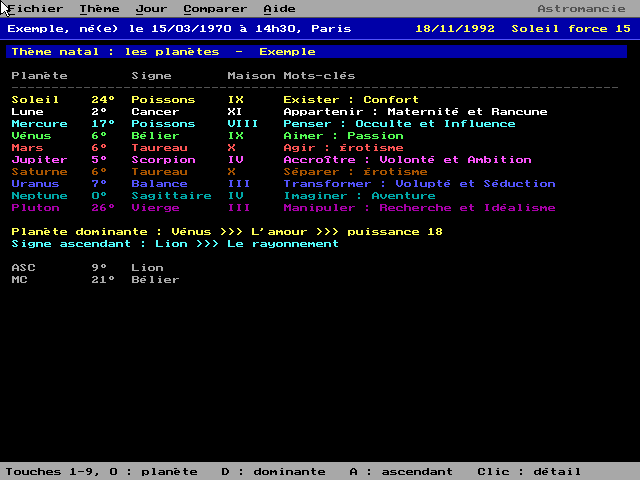 

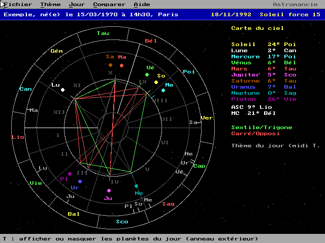 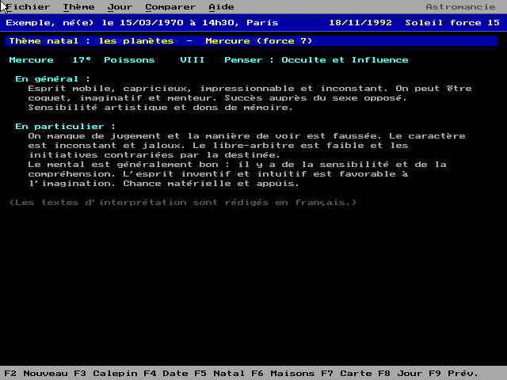

<h3>Le jour : thème du jour, prévisions et tarot</h3>

Le menu <b>Jour</b> calcule le ciel d'une date choisie (F4, par défaut la date du jour) à midi T.U. Le <b>Thème du jour</b> (F8) situe chaque planète du jour par rapport au thème natal (maison dont elle est maîtresse) et désigne la dominante du jour avec sa force. Les <b>Prévisions</b> (F9) retiennent les aspects du thème natal, en commençant par ceux de la dominante du jour, que les mêmes planètes reforment dans le ciel du jour, et en donnent l'interprétation. Le <b>Tarot astrologique</b> tire l'arcane correspondant au signe et au décan occupés par la dominante du jour.

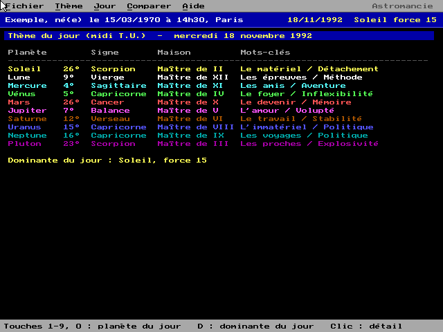 

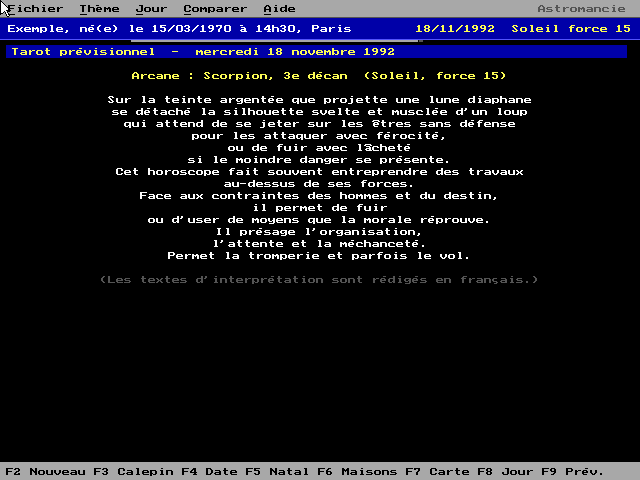 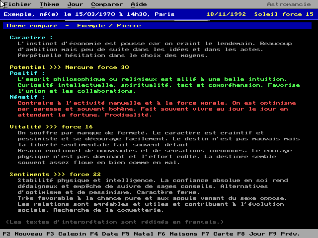

<h3>Calepin et thème comparé</h3>

Le calepin (F3) conserve les personnes saisies ; on y ouvre ou supprime un horoscope. Le menu <b>Comparer &gt; Thème comparé</b> combine le thème courant avec celui d'une personne du calepin par leurs points médians et en décrit le caractère, le potentiel, la vitalité et les sentiments. <b>Fichier &gt; Exporter la page</b> enregistre la page affichée dans le fichier texte ASTROMAN.TXT.

<h3>Utilisation</h3>

Le programme se pilote à la souris ou au clavier : menus déroulants (F10, Alt+lettre soulignée, flèches, Entrée, Échap), touches de fonction (F1 aide, F2 nouveau, F3 calepin, F4 date, F5 à F9 pour les pages), défilement avec Haut, Bas, PgPréc et PgSuiv, et Alt+X pour quitter.

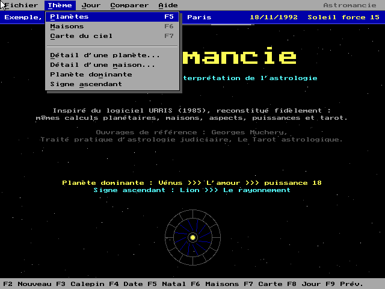

L'interface est en français par défaut. Elle passe en anglais, en allemand, en espagnol ou en italien selon la variable d'environnement LANGUAGE (EN, GR, SP ou IT) ; les textes d'interprétation restent rédigés en français.

<pre>SET LANGUAGE=EN
ASTROMAN</pre>

Remarque : à cause du volume des données intégrées (environ 450 Ko), ASTROMAN.PAS se compile avec Free Pascal ; il dépasse la limite de 64 Ko de données de Turbo Pascal. Sous Linux, ajoutez l'unité de fils d'exécution exigée par PtcGraph : <b>fpc -Facthreads ASTROMAN.PAS</b>.

<h2>Interpréteur de rêves (REVES.PAS)</h2>

L'Interpréteur de rêves est un logiciel graphique qui analyse le récit d'un rêve. On écrit le rêve dans un éditeur de texte intégré, puis le programme repère les symboles et les émotions du récit et en tire un rapport : tonalité positive ou négative, graphiques à secteurs des thèmes et des domaines de vie, classification du rêve, archétypes de Jung et, pour finir, le sens du rêve. L'interprétation s'appuie sur l'onirologie traditionnelle et sur la psychologie des profondeurs (Freud, Jung).

Tout tient dans un seul fichier. Les données sont intégrées sous forme de constantes :
<ul>
 <li>un dictionnaire de 442 symboles répartis en 18 catégories (eau et nature, animaux, corps, personnes, maison et lieux, objets, voyages, actions, éléments, spiritualité, vie et mort, nourriture, argent, vêtements, amour, couleurs et nombres, violence, fantastique) ; chaque symbole a son sens général, sa nuance en contexte favorable ou pénible, sa polarité, ses domaines de vie et son archétype ;</li>
 <li>un lexique de 17 831 mots-clés en cinq langues ;</li>
 <li>un lexique de près de 500 mots d'émotion répartis en neuf classes : joie, amour, sérénité, émerveillement, peur, anxiété, colère, tristesse, honte ;</li>
 <li>les négations et les intensifs (« je n'avais pas peur », « très peur »).</li>
</ul>
Le récit peut être rédigé en français, en anglais, en allemand, en espagnol ou en italien : la langue est détectée automatiquement.

<h3>Écrire le rêve</h3>

Le menu <b>Fichier &gt; Nouveau rêve</b> (F2) ouvre la fiche du rêve : titre, date, rêveur, humeur au réveil, langue du récit et indicateurs « rêve récurrent » et « rêve lucide ». Le récit s'écrit ensuite dans l'éditeur (F5), qui revient à la ligne automatiquement. Pendant la frappe, les symboles reconnus sont surlignés en jaune, les émotions positives en vert et les négatives en rouge. La touche Tab (ou <b>`</b>) ajoute ou change l'accent de la lettre qui précède le curseur (e, é, è, ê, ë). Elle sert lorsque le clavier ne transmet pas les lettres accentuées, comme avec PtcGraph sous Free Pascal. Le menu <b>Rêve &gt; Exemple de rêve</b> charge un récit d'exemple dans la langue de l'interface.

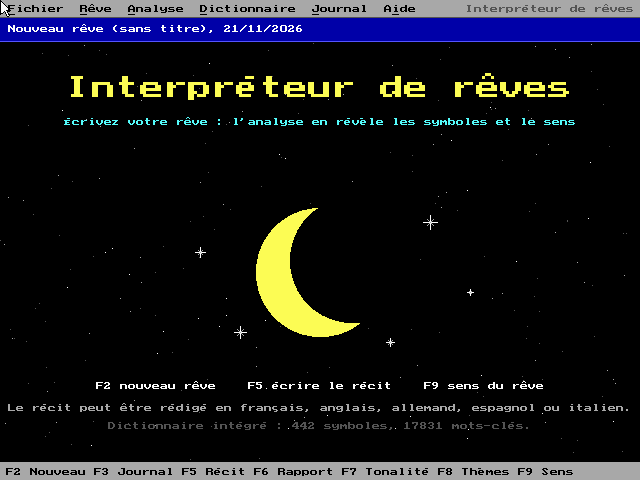 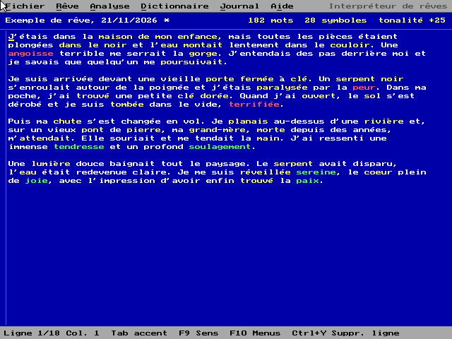

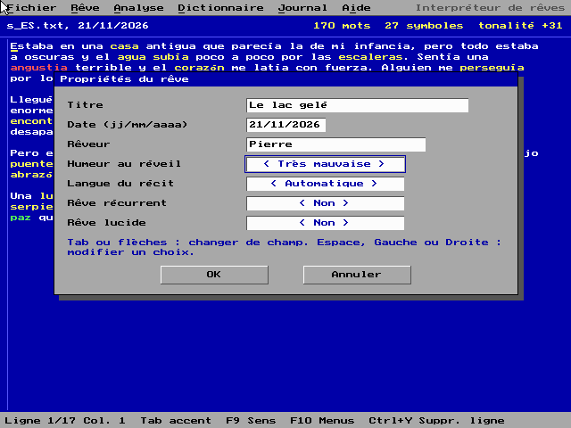 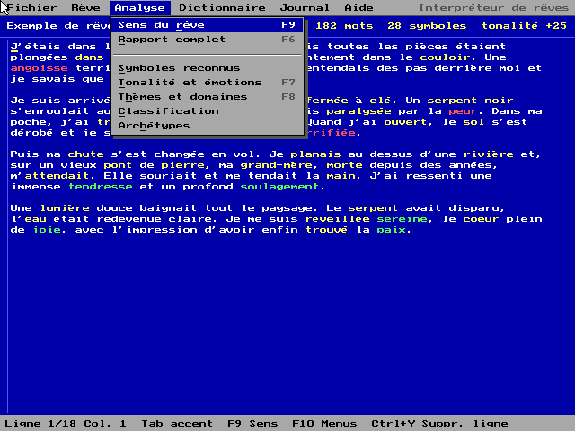

<h3>L'analyse</h3>

Le menu <b>Analyse</b> présente plusieurs pages :
<ul>
 <li><b>Sens du rêve</b> (F9) : la synthèse. Elle décrit la tonalité, l'émotion dominante, le thème et le domaine de vie principaux, les symboles clés interprétés selon leur contexte, le type de rêve, l'évolution du récit, l'archétype marquant, le lien avec l'humeur au réveil et un conseil.</li>
 <li><b>Rapport complet</b> (F6) : tous les éléments de l'analyse. Un clic sur un symbole ouvre sa fiche.</li>
 <li><b>Tonalité et émotions</b> (F7) : la part des éléments positifs, négatifs et neutres en secteurs, l'indice de tonalité de -100 à +100, les neuf émotions et l'évolution émotionnelle du début à la fin du récit.</li>
 <li><b>Thèmes et domaines</b> (F8) : deux graphiques à secteurs, l'un pour les thèmes, l'autre pour les domaines de vie.</li>
 <li><b>Classification</b> : les douze types de rêves, à savoir cauchemar, angoisse, désir, affectif, aventure, fantastique, spirituel, transformation, mémoire, prémonitoire, lucide et récurrent.</li>
 <li><b>Archétypes</b> : l'Ombre, l'Anima ou l'Animus, la Persona, le Soi, la Grande Mère, le Père, le Vieux Sage, l'Enfant divin, le Héros et le Fripon.</li>
</ul>

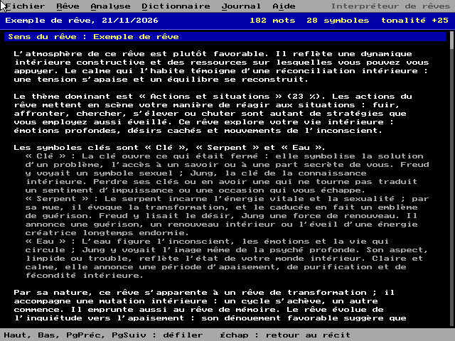 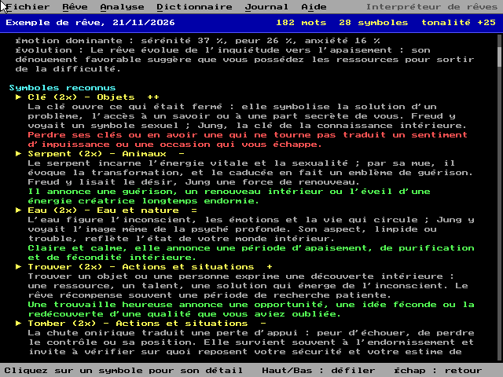

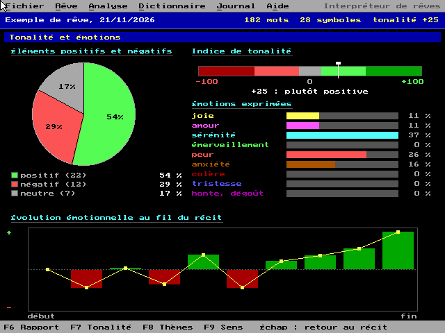 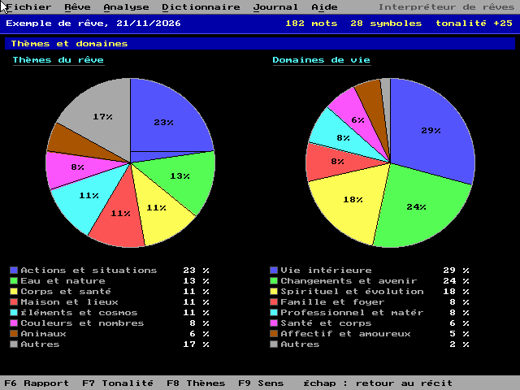

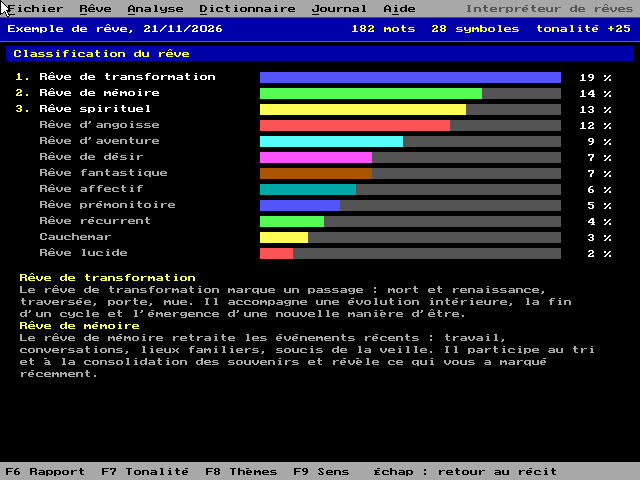 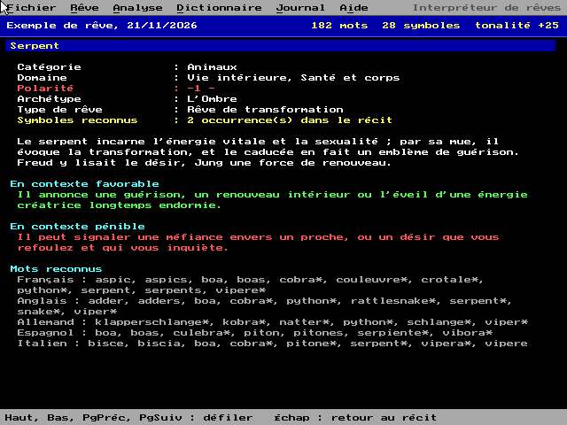

<h3>Dictionnaire, journal et rapport</h3>

Le menu <b>Dictionnaire</b> permet de parcourir les 442 symboles par catégorie ou d'en rechercher un par un mot, dans n'importe laquelle des cinq langues. La fiche d'un symbole donne son sens, ses nuances et les mots qui le font reconnaître.

<b>Fichier &gt; Enregistrer au journal</b> (F4) conserve le rêve dans le fichier <b>REVES.JNL</b> du répertoire courant. La liste du journal (F3) permet de rouvrir un rêve ou de le supprimer. <b>Journal &gt; Statistiques</b> analyse tous les rêves enregistrés et montre la tonalité des derniers rêves, la répartition de leurs types et les symboles qui reviennent le plus souvent. <b>Fichier &gt; Importer un fichier texte</b> charge un récit écrit ailleurs (UTF-8, Latin-1 ou page de code 437). <b>Fichier &gt; Exporter le rapport</b> enregistre l'analyse complète dans un fichier texte (REVES.TXT par défaut).

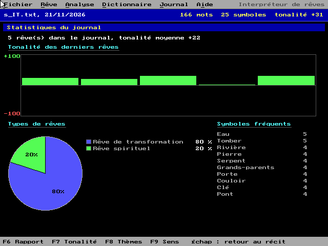

<h3>Utilisation</h3>

Le programme se pilote à la souris ou au clavier :
<ul>
 <li>menus déroulants : F10 ou Alt+lettre soulignée, puis les flèches, Entrée et Échap ;</li>
 <li>touches de fonction : F1 aide, F2 nouveau rêve, F3 journal, F4 enregistrer, F5 récit, F6 rapport, F7 tonalité, F8 thèmes, F9 sens du rêve ;</li>
 <li>défilement des pages : Haut, Bas, PgPréc et PgSuiv ;</li>
 <li>Alt+X pour quitter.</li>
</ul>
Comme pour Astromancie, l'interface suit la variable d'environnement LANGUAGE (EN, GR, SP ou IT) et les interprétations sont rédigées en français.

<pre>SET LANGUAGE=EN
REVES</pre>

Pour vérifier une analyse sans interface graphique :
<ul>
 <li><b>REVES /RAPPORT fichier.txt</b> affiche le rapport complet d'un récit ;</li>
 <li><b>REVES /TEST fichier.txt</b> en donne le détail technique.</li>
</ul>

Remarque : avec environ 650 Ko de données intégrées, REVES.PAS se compile avec Free Pascal ; il dépasse lui aussi la limite de 64 Ko de données de Turbo Pascal. Sous Linux : <b>fpc -Facthreads REVES.PAS</b>.

<h2>Compilation</h2>
	
Les fichiers Pascal n'ont aucune dépendances, il suffit de télécharger le fichier désiré et de le compiler avec Free Pascal avec la syntaxe de commande  :

<pre><b>fpc</b> <i>LEFICHIER.PAS</i></pre>
	
Sinon, vous pouvez également le compiler avec le Turbo Pascal à l'aide de la syntaxe de commande suivante :	

<pre><b>tpc</b> <i>LEFICHIER.PAS</i></pre>
	
Par exemple, si vous voulez compiler SIGN.PAS, vous devrez tapez la commande suivante :

<pre><b>fpc</b> SIGN.PAS</pre>

<h2>Licence</h2>
<ul>
 <li>Le code source est publié sous la licence <a href="https://github.com/gladir/MYSTIX/blob/main/LICENSE">MIT</a>.</li>
 <li>Le paquet original est publié sous la licence <a href="https://github.com/gladir/MYSTIX/blob/main/LICENSE">MIT</a>.</li>
</ul>
