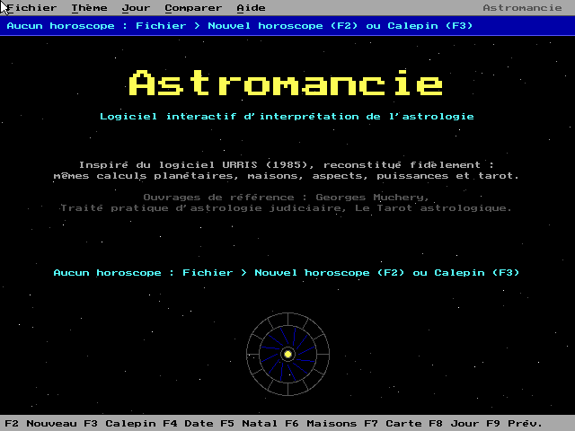
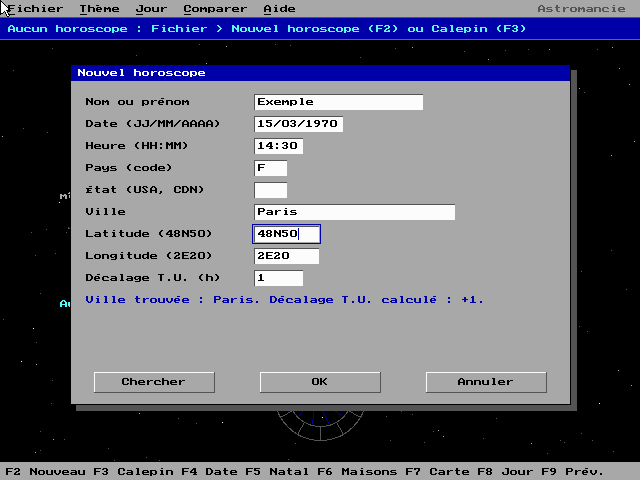
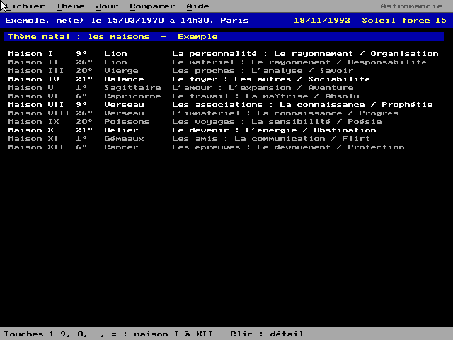
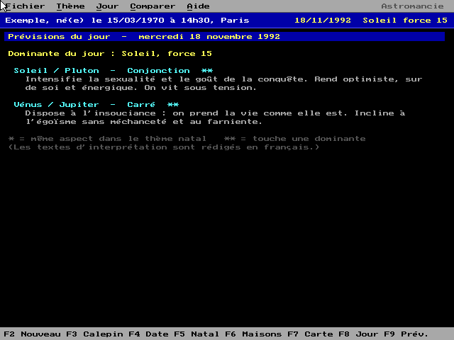

# MYSTIX
Liste de commandes sur le mystique (horoscope, voyance, religion,...) écrit en Pascal  (Turbo Pascal ou Free Pascal).

<h2>Liste des fichiers</h2>

Voici la liste des différents fichiers proposés dans MYSTIX :

<table>
	<tr>
		<th>Nom</th>
		<th>Description</th>	
	</tr>
        <tr>
		<td><b>ASTROMAN.PAS</b></td>
		<td>Astromancie : logiciel graphique interactif d'interprétation de l'astrologie (clone d'URRIS).</td>
	</tr>
        <tr>
		<td><b>DREAM.PAS</b></td>
		<td>Cette commande permet d'analyser le symbolisme et les sentiments dans un rêve.</td>
	</tr>	
        <tr>
		<td><b>EASTER.PAS</b></td>
		<td>Cette commande permet d'afficher la date de la Pâque pour l'année spécifié ou l'année courante.</td>
	</tr>	
	<tr>
		<td><b>MOON.PAS</b></td>
		<td>Cette commande permet d'afficher une phase lunaire dans un mois.</td>
	</tr>	
	<tr>
		<td><b>MYTHOS.PAS</b></td>
		<td>Catalogue mythologique : recherche, divinités, héros, créatures, familles, récits et export JSON/CSV/texte.</td>
	</tr>
	<tr>
		<td><b>NEWAGE.PAS</b></td>
		<td>Cette commande permet de générer du texte aléatoirement surle nouvelle âge (Newage Ipsum).</td>
	</tr>
	<tr>
		<td><b>SIGN.PAS</b></td>
		<td>Cette commande permet d'afficher le signe astrologique.</td>
	</tr>
</table>

<h2>Astromancie (ASTROMAN.PAS)</h2>

Astromancie est un logiciel graphique interactif d'interprétation de l'astrologie. Il reprend fidèlement le logiciel français URRIS, « l'ordinateur astrologique » (Les Éditions du Chariot, 1985), dont l'interprétation s'appuie sur l'œuvre de l'astrologue Georges Muchery (<i>Traité pratique d'astrologie judiciaire</i>, <i>Le Tarot astrologique</i>). Les calculs de l'original ont été reconstitués à l'identique : positions des planètes, système de maisons propre à URRIS (bâti sur le nombre d'or), aspects et orbes, puissance des planètes, dominantes, prévisions, tarot et thème comparé. La présentation, elle, a été entièrement refaite en mode graphique et les textes d'interprétation, autrefois tout en majuscules sans accents, ont été remis en français courant.

Le programme tient dans un seul fichier : tous les textes d'interprétation, les mots-clés, la base de 1831 villes et les décalages horaires historiques par pays (1900 à 1999) sont intégrés sous forme de constantes. Seul le calepin des personnes est enregistré à part, dans le fichier <b>ASTROMAN.CAL</b> créé dans le répertoire courant.

<h3>Saisie d'un horoscope</h3>

Le menu <b>Fichier &gt; Nouvel horoscope</b> (touche F2) ouvre la fiche de saisie : nom, date et heure locale de naissance, code international du pays (F, B, CH, D, I, E, GB, USA, CDN...), état fédéral pour les États-Unis et le Canada, puis la ville. Le bouton <b>Chercher</b> retrouve la latitude et la longitude de la ville et calcule le décalage T.U. en vigueur à la date de naissance (heure d'été comprise). Ces valeurs restent modifiables. Le décalage T.U. est le nombre d'heures à ajouter au temps universel pour obtenir l'heure locale (+1 pour Paris en hiver, -5 pour New York).

 

<h3>Thème natal</h3>

Le menu <b>Thème</b> présente le thème de naissance. La page <b>Planètes</b> (F5) donne pour chaque planète son degré, son signe, sa maison et ses mots-clés, ainsi que la planète dominante avec sa puissance et le signe ascendant. La page <b>Maisons</b> (F6) décrit les douze maisons. Un clic sur une ligne, ou la touche correspondante, ouvre l'interprétation détaillée (« en général » et « en particulier »). La <b>Carte du ciel</b> (F7) dessine le zodiaque, les maisons, les planètes et leurs aspects ; la touche T affiche ou masque les planètes du jour sur l'anneau extérieur.

 

 

<h3>Le jour : thème du jour, prévisions et tarot</h3>

Le menu <b>Jour</b> calcule le ciel d'une date choisie (F4, par défaut la date du jour) à midi T.U. Le <b>Thème du jour</b> (F8) situe chaque planète du jour par rapport au thème natal (maison dont elle est maîtresse) et désigne la dominante du jour avec sa force. Les <b>Prévisions</b> (F9) retiennent les aspects du thème natal, en commençant par ceux de la dominante du jour, que les mêmes planètes reforment dans le ciel du jour, et en donnent l'interprétation. Le <b>Tarot astrologique</b> tire l'arcane correspondant au signe et au décan occupés par la dominante du jour.

 

 

<h3>Calepin et thème comparé</h3>

Le calepin (F3) conserve les personnes saisies ; on y ouvre ou supprime un horoscope. Le menu <b>Comparer &gt; Thème comparé</b> combine le thème courant avec celui d'une personne du calepin par leurs points médians et en décrit le caractère, le potentiel, la vitalité et les sentiments. <b>Fichier &gt; Exporter la page</b> enregistre la page affichée dans le fichier texte ASTROMAN.TXT.

<h3>Utilisation</h3>

Le programme se pilote à la souris ou au clavier : menus déroulants (F10, Alt+lettre soulignée, flèches, Entrée, Échap), touches de fonction (F1 aide, F2 nouveau, F3 calepin, F4 date, F5 à F9 pour les pages), défilement avec Haut, Bas, PgPréc et PgSuiv, et Alt+X pour quitter.

L'interface est en français par défaut. Elle passe en anglais, en allemand, en espagnol ou en italien selon la variable d'environnement LANGUAGE (EN, GR, SP ou IT) ; les textes d'interprétation restent rédigés en français.

<pre>SET LANGUAGE=EN
ASTROMAN</pre>

Remarque : à cause du volume des données intégrées (environ 450 Ko), ASTROMAN.PAS se compile avec Free Pascal ; il dépasse la limite de 64 Ko de données de Turbo Pascal. Sous Linux, ajoutez l'unité de fils d'exécution exigée par PtcGraph : <b>fpc -Facthreads ASTROMAN.PAS</b>.

<h2>Compilation</h2>
	
Les fichiers Pascal n'ont aucune dépendances, il suffit de télécharger le fichier désiré et de le compiler avec Free Pascal avec la syntaxe de commande  :

<pre><b>fpc</b> <i>LEFICHIER.PAS</i></pre>
	
Sinon, vous pouvez également le compiler avec le Turbo Pascal à l'aide de la syntaxe de commande suivante :	

<pre><b>tpc</b> <i>LEFICHIER.PAS</i></pre>
	
Par exemple, si vous voulez compiler SIGN.PAS, vous devrez tapez la commande suivante :

<pre><b>fpc</b> SIGN.PAS</pre>

<h2>Licence</h2>
<ul>
 <li>Le code source est publié sous la licence <a href="https://github.com/gladir/MYSTIX/blob/main/LICENSE">MIT</a>.</li>
 <li>Le paquet original est publié sous la licence <a href="https://github.com/gladir/MYSTIX/blob/main/LICENSE">MIT</a>.</li>
</ul>
